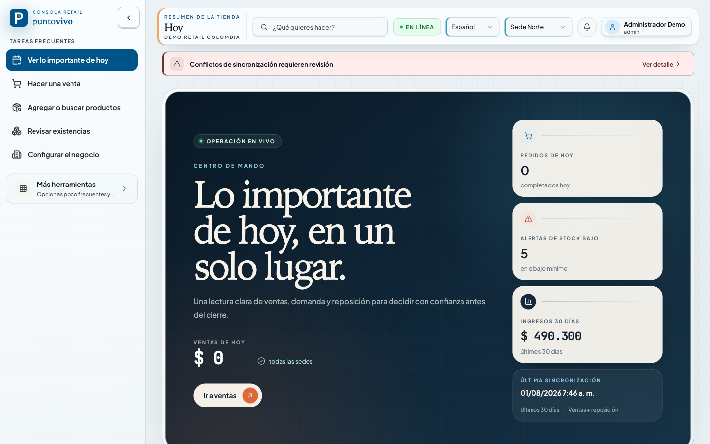
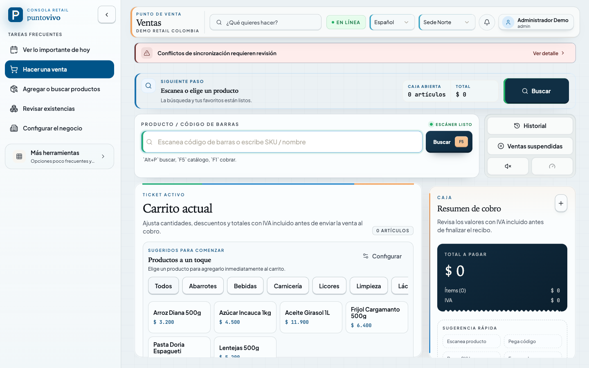
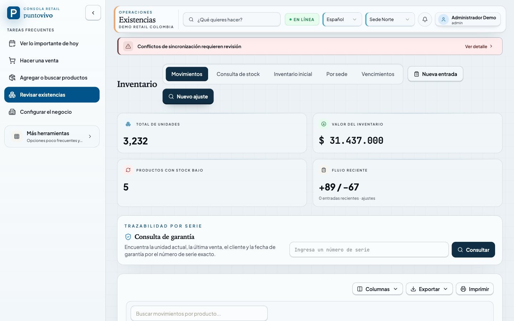
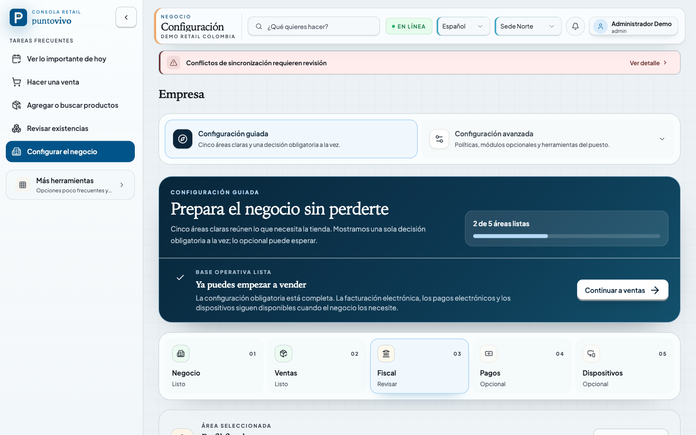

<div align="center">


# Puntovivo

**Idioma:** Español · [English](./README.md)

### Punto de venta local con funciones fiscales para el comercio latinoamericano

Cobro rápido, control de caja, inventario por sede y preparación fiscal sobre
una base SQLite local, con operación sin conexión antes de depender de la nube.

[](./LICENSE)
[](https://github.com/johnny4young/puntovivo/actions/workflows/ci.yml)
[](./package.json)
[](./apps/desktop)
[](./apps/web)
[](./packages/server)

<br />



</div>

---

## Qué es Puntovivo

Puntovivo es un sistema de punto de venta para comercios latinoamericanos. Su
primer segmento comercial es **el comercio minorista colombiano con 1–10 sedes**:
cobro rápido, control de caja, inventario por sede, auditoría y preparación
fiscal. La base local es la fuente de verdad para que la tienda pueda seguir
vendiendo cuando no tenga conexión.

La misma aplicación React se ejecuta en dos destinos: **escritorio con Electron**
y **navegador**, sobre una API **Fastify + tRPC** integrada. En escritorio, el
servidor se ejecuta dentro del proceso principal de Electron y los datos se
guardan en una base **SQLite** local cifrada.

Su alcance no es el de un ERP genérico ni una suite que dependa exclusivamente
de la nube. Restaurante, KDS, IA, entregas, API pública y SaaS alojado existen
como módulos o líneas de trabajo; la condición para producción es que el punto
de venta minorista pueda comercializarse de forma responsable.

## Funciones destacadas

- 🧾 **Funciones fiscales desde la base**: perfiles fiscales por negocio,
  catálogos de identificación DIAN, validación del dígito de verificación del
  NIT, plantillas de recibos y una bandeja fiscal persistente. El documento, el
  avance de su numeración y su incorporación a la bandeja se confirman en una
  sola transacción de escritura.
- 📲 **Envío de recibos bajo control del operador**: una venta completada puede
  generar un recibo de texto para el cliente, preparar un PNG localmente y abrir
  WhatsApp para que el operador lo revise, adjunte y envíe. Puntovivo no carga ni
  envía el recibo en segundo plano.
- 🛒 **Cobro con códigos de barras**: escaneo o ingreso de SKU, carrito controlado
  por teclado (`Alt+P` para buscar, `Alt+C` para cantidad y `Alt+D` para descuento),
  ventas suspendidas y resumen de pago con IVA incluido.
- 💵 **Control de caja**: una sesión abierta por caja, cierre ciego o con saldo
  visible, libro de movimientos con una invariante de saldo esperado y cierre
  diario de 60 segundos con margen bruto real y semáforo de conciliación.
- 📦 **Inventario por sede**: autoridad de existencias por sede, agregado
  materializado mantenido por triggers de SQLite, lotes FEFO y radar de
  vencimientos que muestra el valor en riesgo. El mismo modelo incluye matrices
  de variantes, logística por número de serie, consulta de garantías y
  transferencias exactas entre sedes.
- 👥 **Personal y prevención de pérdidas**: cambio de empleado en terminal
  compartida, horarios, evidencia de asistencia, correcciones, clasificación de
  horas extra, autorizaciones del gerente y alertas auditables por sede.
- 💾 **Recuperación operativa**: almacenamiento y paquetes de respaldo cifrados,
  instantáneas programadas, ensayos de restauración, carga a una bóveda compatible
  con S3, disposición de datos privados, controles de retención e importación
  guiada para iniciar operaciones.
- 📥 **Importaciones según el origen**: perfiles versionados para fixtures
  locales sin datos privados con estructuras de exportaciones de Loyverse,
  Alegra, Siigo y World Office. Los formatos desconocidos o modificados usan el
  mapeo genérico; cada importación requiere vista previa y confirmación. La
  aceptación con cuentas reales de terceros sigue pendiente de validación externa.
- 🔒 **Aislamiento entre negocios**: cada consulta se limita al negocio; los
  controles de roles y sede son componentes compartidos, y las pruebas verifican
  el aislamiento entre negocios.
- 🌎 **Interfaz bilingüe y operación sin conexión**: español latinoamericano
  neutro e inglés, autoridad SQLite local y un núcleo persistente de bandejas
  y sincronización para replicación futura en la nube.

## Capturas de pantalla

<div align="center">

|                                                                        Punto de venta                                                                        |                                                                      Inventario                                                                       |
| :----------------------------------------------------------------------------------------------------------------------------------------------------------: | :---------------------------------------------------------------------------------------------------------------------------------------------------: |
|  |  |
|                                                           **Configuración guiada y perfil fiscal**                                                           |                                                                                                                                                       |
|  |                                                                                                                                                       |

</div>

> Las capturas muestran la interfaz en español. Puntovivo permite cambiar entre
> español latinoamericano neutro e inglés por usuario.

## Estado actual

Puntovivo está en desarrollo activo. Condiciones de preparación:

| Etapa                      | Estado                              | Motivo                                                                                                                                                                                                                                                                                                                     |
| -------------------------- | ----------------------------------- | -------------------------------------------------------------------------------------------------------------------------------------------------------------------------------------------------------------------------------------------------------------------------------------------------------------------------- |
| Demostración de desarrollo | Lista                               | El núcleo minorista, personal, inventario por número de serie, importación inicial, privacidad, respaldos y operaciones pueden demostrarse y tienen pruebas automatizadas.                                                                                                                                                 |
| Beta interna controlada    | Lista con verificaciones de release | Los releases de escritorio publicados requieren instalación limpia en equipos representativos, actualización mediante el actualizador de producción y rechazo de versiones anteriores. La matriz documentada de empaquetado y recuperación v1.10.1 es evidencia histórica de regresión; no valida los artefactos actuales. |
| Piloto minorista privado   | Aún no                              | Faltan contingencia fiscal, transmisión por proveedor certificado, evidencia final del recibo fiscal y validación de hardware POS físico.                                                                                                                                                                                  |
| Venta en producción        | No                                  | Requiere certificación fiscal, evidencia legal de conservación, validación de hardware, alertas entregadas externamente, política de terminales de pago y un piloto observado.                                                                                                                                             |

El inventario canónico de capacidades, las brechas pendientes y los requisitos
para releases están en [docs/PROJECT-STATUS.md](docs/es/PROJECT-STATUS.md).

### Validaciones externas pendientes

- La integración real con un proveedor DIAN requiere contrato, credenciales,
  certificado y resolución de numeración.
- La certificación de impresoras, cajones, lectores y terminales requiere un
  laboratorio físico.
- El candidato histórico v1.10.1 pasó el entorno empaquetado y las nueve
  verificaciones de recuperación cifrada en Linux, macOS y Windows en la
  [ejecución 31264233582](https://github.com/johnny4young/puntovivo/actions/runs/31264233582).
  Esa matriz de validación es evidencia de regresión para v1.10.1; no valida
  binarios posteriores, firmas de releases ni promete tiempos de recuperación
  en producción. El [release v1.14.4](https://github.com/johnny4young/puntovivo/releases/tag/v1.14.4)
  y la [política activa de actualización](https://johnny4young.github.io/puntovivo/update-policy.json)
  no sustituyen la evidencia de Gate 5 en equipos representativos.
- El artefacto macOS es para Apple Silicon y declara macOS 15 Sequoia como
  mínimo. El workflow de candidatos prueba por separado Sequoia 15 y Tahoe 26;
  actualmente no hay un artefacto compatible con Intel.
- Antes de un piloto privado se requiere evidencia moderada con cajeros no
  técnicos y un receptor externo de alertas configurado, observado y con
  responsables explícitos. La ruta de software de entregas firmadas está
  implementada; no existe un servicio de monitoreo atendido por personal.
- SaaS alojado, negocios de demostración públicos, clonación de negocios y
  microtiendas dependen de la investigación de la infraestructura de alojamiento.
- La profundidad de restaurante, KDS, servicios o farmacia avanza cuando un
  piloto define esa vertical como prioridad.

## Tecnologías

| Capa          | Elección                                                | Notas                                                                                |
| ------------- | ------------------------------------------------------- | ------------------------------------------------------------------------------------ |
| Escritorio    | Electron 43.5.0 + empaquetado con electron-builder      | SQLite usa un binario Node-API incluido por plataforma.                              |
| Web           | React 19 + Vite 8 + TypeScript 7 (API TS 6 para ESLint) | El navegador y el renderer de Electron comparten el código de la aplicación.         |
| API           | Fastify + tRPC 11                                       | `/api/trpc` es la API canónica de la aplicación.                                     |
| Base de datos | SQLite mediante better-sqlite3-multiple-ciphers         | SQLCipher está integrado; los modos de desarrollo pueden compartir una base cifrada. |
| ORM           | Drizzle                                                 | Las migraciones son la única vía de cambios de esquema.                              |
| Estado        | TanStack Query + Zustand                                | Se separan el estado del servidor y el de la interfaz.                               |
| Estilos       | Tailwind CSS v4 + CVA                                   | Consulta [docs/STYLING.md](docs/es/STYLING.md).                                      |
| Tiempo real   | SSE                                                     | `/api/realtime/*` sigue disponible para actualizaciones en vivo.                     |

<div align="center">



</div>

La aplicación de escritorio importa `@puntovivo/server` directamente en el
proceso principal de Electron; no inicia el servidor como un proceso hijo.

## Inicio rápido

### Requisitos

- Node.js `>=24.0.0`
- pnpm `11.x` mediante Corepack o una instalación local compatible

```bash
corepack enable
pnpm install
./scripts/check-setup.sh
```

pnpm 11 bloquea los scripts de compilación de dependencias que no estén
permitidos. La lista está en [pnpm-workspace.yaml](./pnpm-workspace.yaml) y cubre
los componentes que aún tienen hooks de ciclo de vida: argon2 y esbuild.
better-sqlite3-multiple-ciphers v13 incluye binarios Node-API con integridad
verificada y su compilación implícita en pnpm se deniega explícitamente.
Electron 43.5.0, como la línea 42 anterior, no tiene hook de instalación:
Puntovivo instala su entorno de desarrollo cuando lo necesita, durante la
verificación previa de escritorio. Si la instalación muestra
`ERR_PNPM_IGNORED_BUILDS`, revisa el paquete y registra una política explícita
true/false antes de instalar de nuevo.

### Ejecución

```bash
pnpm run dev:desktop   # web dev server + Electron desktop
# or
pnpm run dev:web-stack # web app + standalone backend, in the browser
```

En una instalación interactiva nueva, crea la empresa y su primer propietario
desde la pantalla de acceso. En web independiente, la creación solo se admite
desde el mismo equipo y requiere el código privado de instalación que muestra
el servidor. Si la base ya tiene propietario, usa su cuenta real. Consulta
[la guía de acceso](./docs/es/LOGIN_GUIDE.md).

### Fixtures de desarrollo explícitos

Las credenciales de prueba no se habilitan automáticamente al iniciar la
aplicación. El tooling explícito para datos desechables puede crear
`admin@localhost`. Su contraseña inicial es `Admin123!Dev` (o
`PUNTOVIVO_DEV_ADMIN_PASSWORD`) solo si al menos uno de `NODE_ENV` y
`PUNTOVIVO_RUNTIME_ENV` está declarado y cada marcador declarado vale
`development` o `test`; de lo contrario, se genera. El conjunto de demostración
usa `admin@demo.co`. Antes de ejecutar `pnpm run seed:dev`, elige
una base desechable propia y lee [DEV-SEED.md](./docs/es/DEV-SEED.md). Estas
credenciales no sirven para recuperar el acceso a una instalación real.

## Comandos de desarrollo

Ejecuta los comandos desde la raíz del repositorio.

| Tarea                                       | Comando                      |
| ------------------------------------------- | ---------------------------- |
| Entorno de escritorio                       | `pnpm run dev:desktop`       |
| Solo shell de Electron                      | `pnpm run dev:desktop-shell` |
| Solo aplicación web                         | `pnpm run dev:web`           |
| Web + backend independiente                 | `pnpm run dev:web-stack`     |
| Solo backend                                | `pnpm run dev:server`        |
| Detener procesos del lanzador de desarrollo | `pnpm run dev:stop`          |
| Idiomas de documentación                    | `pnpm run ci:docs`           |
| Validación CI web                           | `pnpm run ci:web`            |
| Validación CI del servidor                  | `pnpm run ci:server`         |
| Validación CI de escritorio                 | `pnpm run ci:desktop`        |
| E2E web                                     | `pnpm run test:e2e:web`      |
| E2E Electron                                | `pnpm run test:e2e:electron` |
| Compilar paquete de escritorio              | `pnpm run build:desktop`     |

### Notas del entorno nativo

better-sqlite3-multiple-ciphers v13 usa Node-API, por lo que Node 24 independiente
y Electron 43 cargan el mismo binario de la plataforma. Verifica ambas rutas con:

```bash
pnpm --filter @puntovivo/server run native:ensure:node
pnpm --filter @puntovivo/desktop run rebuild
```

El nombre `rebuild` se mantiene por compatibilidad, pero ahora verifica la ruta
Node-API de Electron sin invocar node-gyp. El empaquetado de producción conserva
solo el binario SQLite precompilado del sistema operativo y arquitectura
correspondientes, y falla si ese binario no está disponible.

## Documentación

Comienza por [docs/README.md (índice en español)](./docs/es/README.md). Resumen:

- [docs/PROJECT-STATUS.md](docs/es/PROJECT-STATUS.md): capacidades disponibles, brechas y preparación para releases.
- [docs/ARCHITECTURE.md](docs/es/ARCHITECTURE.md): estructura actual del sistema.
- [docs/TESTING.md](docs/es/TESTING.md): contrato de validación y verificaciones de candidatos a release.
- [docs/ENVIRONMENT_CONFIGURATION.md (español)](./docs/es/ENVIRONMENT_CONFIGURATION.md): referencia de variables de entorno.
- [docs/DESKTOP_RUNTIME_GUIDE.md](docs/es/DESKTOP_RUNTIME_GUIDE.md): entorno de ejecución de Electron.
- [docs/SECURITY.md (español)](./docs/es/SECURITY.md): autenticación, endurecimiento y política de auditoría.

## Contribuir

Las contribuciones son bienvenidas. Lee primero
[CONTRIBUTING.md (español)](./CONTRIBUTING.es.md) y el
[Código de conducta (español)](./CODE_OF_CONDUCT.es.md), y ejecuta la validación de CI
del área modificada:

| Área                                                  | Comando                      |
| ----------------------------------------------------- | ---------------------------- |
| `apps/web` React o TypeScript                         | `pnpm run ci:web`            |
| `packages/server` backend                             | `pnpm run ci:server`         |
| `apps/desktop/src/main` proceso principal de Electron | `pnpm run ci:desktop`        |
| E2E web / inicio de sesión / ventas / inventario      | `pnpm run test:e2e:web`      |
| Inicio de Electron / E2E                              | `pnpm run test:e2e:electron` |

Todo cambio visible en la interfaz requiere además una comprobación en vivo de
web o Electron. Para problemas de seguridad, consulta
[docs/SECURITY.md (español)](./docs/es/SECURITY.md); no abras un issue público para una
vulnerabilidad.

## Licencia

[MIT](./LICENSE) © Johnny IV Young Ospino
