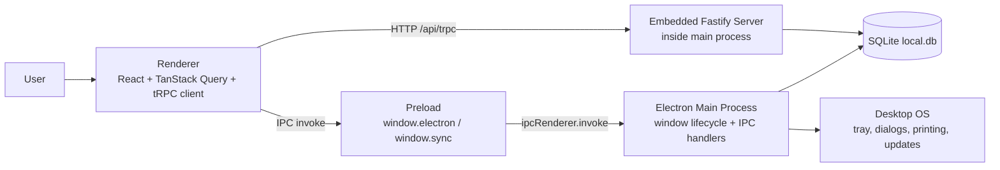
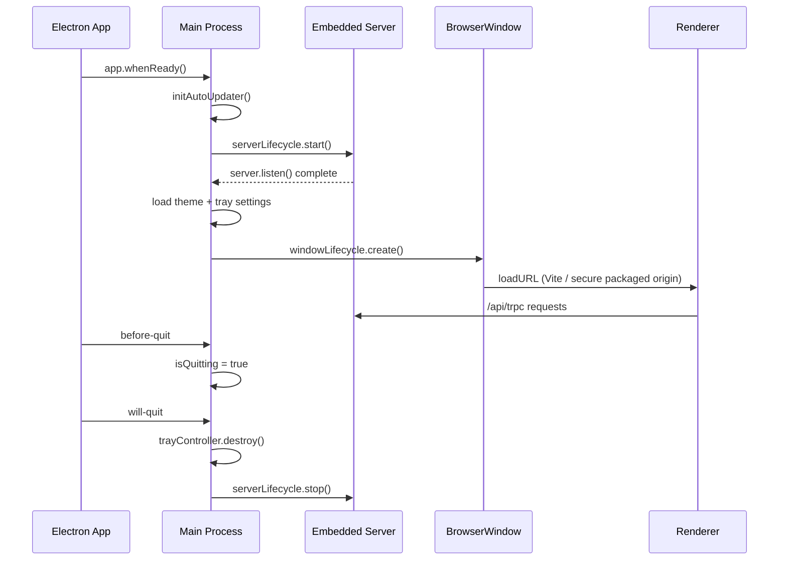
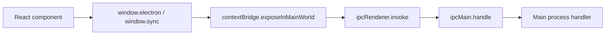

# Guía del runtime de escritorio

**Idioma:** Español · [English](../DESKTOP_RUNTIME_GUIDE.md)

> Actualizado: 15 de octubre de 2026
> Audiencia: desarrolladores que necesitan comprender el comportamiento del runtime de Electron en Puntovivo

## Contrato de macOS compatible

La versión de escritorio es compatible con **Apple Silicon en macOS 15 Sequoia y macOS 26 Tahoe**. `LSMinimumSystemVersion` está fijado en `15.0`; la versión del sistema operativo no implica compatibilidad con Intel, que hoy no tiene un artefacto de distribución. El flujo manual de candidatos ejecuta comprobaciones del paquete, del renderizador y de recuperación cifrada en ambas generaciones de runners arm64 fijadas. El artefacto firmado se construye en el runner de Tahoe fijado, en lugar de la etiqueta móvil `macos-latest`.

Las futuras versiones mayores de macOS entrarán en el contrato de soporte solo cuando aprueben las comprobaciones de módulos nativos, runtime empaquetado, renderizador, recuperación y máquinas representativas. No extrapoles un resultado de Tahoe a Sequoia ni a versiones futuras.

La cadena de herramientas actual usa Node 24+, Electron 43.5.0 y `better-sqlite3-multiple-ciphers` 13.0.3. SQLite usa binarios precompilados portables de Node-API compartidos por Node independiente y Electron. Verifica el binario instalado con `pnpm --filter @puntovivo/server run native:ensure:node` y `pnpm --filter @puntovivo/desktop run native:ensure:electron`; no lo recompiles ni intercambies binarios entre runtimes. El script de escritorio `rebuild` es un alias de compatibilidad para la verificación. El empaquetado verifica el runtime de Electron y elimina los binarios precompilados innecesarios dentro de su directorio de preparación, sin reemplazar el binario del checkout.

## Por qué existe este documento

El repositorio ya tenía información parcial distribuida entre:

- `docs/ARCHITECTURE.md`
- `docs/DEBUGGING.md`
- `apps/desktop/src/main/index.ts`
- `apps/desktop/src/preload/index.ts`

Faltaba un documento que explicara en un solo lugar:

1. el ciclo de vida de la aplicación de escritorio
2. cómo está estructurado IPC y por qué se expone de esa manera
3. qué significa "watch-state" en este repositorio y cómo se usa realmente

Esta guía cubre esa necesidad.

## Versión breve

Puntovivo de escritorio es una aplicación Electron con esta estructura:

- el proceso principal de Electron aloja y coordina la aplicación
- el servidor Fastify está integrado dentro del proceso principal de Electron
- React se ejecuta en el renderizador
- el renderizador nunca se comunica directamente con Node ni SQLite
- preload expone un puente IPC acotado al renderizador
- la mayoría de los datos de la aplicación siguen pasando por HTTP/tRPC hacia el servidor integrado
- IPC directo se usa principalmente para capacidades exclusivas de escritorio

Por tanto, el runtime de escritorio no es "frontend + proceso de backend local separado". Es "el proceso principal de Electron aloja tanto el backend como las integraciones con el sistema operativo de escritorio".

## Diagrama general



## 1. Ciclo de vida del proyecto

### Qué significa "ciclo de vida" aquí

En este proyecto, el ciclo de vida es la secuencia de ejecución de la aplicación de escritorio Electron:

1. Electron se inicia
2. arranca el proceso principal
3. se inicia el servidor Fastify integrado
4. se cargan las preferencias de escritorio desde SQLite
5. se crea la ventana principal del navegador
6. el renderizador carga el servidor de desarrollo de Vite o `puntovivo-app://app/index.html` desde los recursos empaquetados
7. las capacidades de bandeja / tema / actualizaciones / impresión / respaldo siguen disponibles a través del proceso principal
8. al salir, el proceso principal destruye la bandeja y apaga el servidor integrado

### Flujo real de arranque del proyecto

El punto de entrada principal es:
[index.ts](../../apps/desktop/src/main/index.ts)

La ruta principal del ciclo de vida es:

1. `app.whenReady()` espera a que Electron esté listo.
2. `initAutoUpdater()` inicializa el estado de actualización del escritorio.
3. `serverLifecycle.start()` inicia Fastify en el puerto de loopback integrado (por defecto 127.0.0.1:8090).
4. se cargan los ajustes de tema y bandeja desde `app_settings`.
5. `windowLifecycle.create()` crea el `BrowserWindow` principal.
6. `trayController.refresh()` crea o actualiza la bandeja si está habilitada.
7. `app.on('activate')` restaura o vuelve a crear la ventana principal según el comportamiento de macOS.
8. `app.on('before-quit')` marca que la aplicación está saliendo intencionalmente.
9. `app.on('will-quit')` destruye los recursos de la bandeja, detiene el actualizador y ejecuta el apagado ordenado: detener el programador de respaldos, vaciar la cola de operaciones de respaldo, detener el servidor integrado y limpiar los archivos de preparación de restauración pendientes.

Código relevante:

- [index.ts](../../apps/desktop/src/main/index.ts)

### Diagrama de secuencia del ciclo de vida



### Por qué el backend está integrado en el proceso principal

Esta es una de las decisiones de arquitectura más importantes del repositorio.

El proyecto explícitamente no inicia un proceso de servidor separado en modo escritorio. El proceso principal de Electron importa `@puntovivo/server` directamente e inicia Fastify dentro del mismo proceso.

Motivos:

- empaquetado más sencillo: un runtime de escritorio controla la ventana de la aplicación, la base de datos local y el servidor HTTP local
- menos elementos de despliegue: no se necesita supervisar un proceso hijo adicional
- menor complejidad de coordinación local: el respaldo y la restauración pueden detener y reiniciar directamente el servidor integrado
- acceso más sencillo a recursos locales compartidos como `local.db`, ajustes de bandeja, ajustes de impresión y metadatos de sincronización

Compensaciones técnicas:

- el proceso principal adquiere importancia operativa porque controla tanto el ciclo de vida de la ventana como el del backend
- si el proceso principal falla, tanto el shell de escritorio como el servidor local se detienen juntos
- las responsabilidades exclusivas de escritorio deben mantenerse acotadas para que el proceso principal no se convierta en una capa de servicios enorme y sin control

### Qué se usa hoy en el ciclo de vida

Se usa:

- `app.whenReady()`
- `app.on('activate')`
- `app.on('before-quit')`
- `app.on('window-all-closed')`
- `app.on('will-quit')`
- `BrowserWindow`
- `Tray`
- helpers para iniciar/detener/reiniciar Fastify integrado

No se usa como modelo principal:

- proceso hijo de backend separado
- acceso directo a Node desde el renderizador
- acceso directo a SQLite desde el renderizador

### Cómo cambia el ciclo de vida al cerrar a la bandeja

El cierre de la ventana intencionalmente no siempre equivale a salir de la aplicación.

Si la bandeja está habilitada y `closeToTray` está habilitado:

- hacer clic en el botón de cierre no termina el proceso
- `mainWindow.on('close')` evita el comportamiento por defecto
- la ventana se oculta
- la bandeja mantiene la aplicación activa

Si `closeToTray` está deshabilitado:

- se permite cerrar la ventana; `window-all-closed` sale en plataformas distintas de macOS, mientras macOS mantiene la aplicación disponible para activarla

Motivos:

- el software de escritorio de tipo POS suele necesitar disponibilidad para reabrirse rápidamente
- evita arranques en frío repetidos durante el uso de la estación de trabajo

### Por qué el respaldo y la restauración usan un reinicio del servidor

El respaldo manual y la restauración destructiva detienen el servidor integrado durante la operación de archivos. Las instantáneas programadas usan el helper compartido de instantáneas y no todas requieren reiniciar el servidor.

El proyecto usa:

- `runWithServerRestart(...)` (inyectado como `serverLifecycle.restartAround`)
- `serverLifecycle.stop()`
- operación de archivos
- `serverLifecycle.start()`
- recarga opcional del renderizador

Motivos:

- reemplazar el archivo SQLite es más seguro cuando el servidor integrado no lo mantiene abierto
- evita riesgos de corrupción de la base de datos y manejadores de archivo obsoletos
- garantiza que el servidor se conecte correctamente al archivo restaurado

Este es un buen ejemplo de por qué resulta útil que el proceso principal controle el ciclo de vida integrado.

## 2. IPC

### Qué significa IPC aquí

IPC en Electron es el canal de comunicación entre:

- proceso del renderizador
- puente de preload
- proceso principal

En Puntovivo, IPC se usa solo para capacidades nativas o privadas del escritorio.

La API de negocio sigue siendo principalmente tRPC sobre HTTP.

Esa distinción importa:

- lógica de negocio: normalmente `/api/trpc`
- capacidades de escritorio: normalmente `ipcRenderer.invoke(...)`

### Capas de IPC en este repositorio

```text
Renderer code
  -> window.electron / window.sync
  -> preload bridge
  -> ipcRenderer.invoke(channel, payload)
  -> ipcMain.handle(channel, handler)
  -> Electron main code
```

Archivos relevantes:

- [index.ts](../../apps/desktop/src/preload/index.ts)
- [index.d.ts](../../apps/desktop/src/preload/index.d.ts)
- [index.ts](../../apps/desktop/src/main/index.ts)

### Por qué existe preload

El renderizador se ejecuta con:

- `sandbox: true`
- `contextIsolation: true`
- `nodeIntegration: false`

Por tanto, el renderizador no puede ni debe llamar directamente las API de Node/Electron.

Preload existe para exponer una superficie controlada en `window`.

Este proyecto expone:

- `window.electron`
- `window.sync`
- `window.session`
- `window.api` como superficie agregada de compatibilidad

Motivos:

- mantiene las capacidades de Node/Electron fuera del código arbitrario del renderizador
- hace explícita la API de escritorio permitida
- mejora la seguridad frente a habilitar la integración de Node en el renderizador
- permite tipar el puente de escritorio con TypeScript

### Diagrama de IPC



### Qué canales IPC se usan

El repositorio usa actualmente canales de solicitud/respuesta `ipcMain.handle(...)` / `ipcRenderer.invoke(...)`.

Ejemplos:

Shell de escritorio / estación de trabajo:

- `get-app-version`
- `get-app-path`
- `get-server-url`
- `get-auto-update-status`
- `check-for-app-updates`
- `restart-to-apply-app-update`
- `get-tray-settings`
- `update-tray-settings`
- `get-theme-preference`
- `update-theme-preference`
- `get-receipt-print-settings`
- `update-receipt-print-settings`
- `create-database-backup`
- `restore-database-backup`
- `print-receipt`

Puente de sincronización de escritorio:

- `sync:getStatus`
- `sync:triggerSync`
- `sync:setConfig`

### Por qué este proyecto usa invoke/handle en lugar de IPC por eventos

El repositorio usa principalmente IPC de solicitud/respuesta porque coincide con la forma en que la interfaz consume las capacidades de escritorio:

- consultar los ajustes de bandeja
- guardar la preferencia de tema
- crear un respaldo
- iniciar una sincronización
- imprimir un recibo

Todas son operaciones de comando o consulta con un valor de retorno natural.

Ventajas técnicas en este contexto:

- más fácil de tipar
- más fácil de razonar que buses de eventos libres
- más fácil de probar porque cada canal corresponde a una función
- propagación de errores más sencilla porque la promesa se rechaza o resuelve

Qué no se usa de forma intensiva:

- canales IPC de streaming de larga duración
- bus de eventos del renderizador al proceso principal para sincronizar el estado de negocio
- almacén de estado de escritorio de publicación/suscripción de propósito general

### Por qué la mayoría de los datos de negocio no pasan por IPC

El proyecto mantiene intencionalmente el CRUD de negocio en tRPC en lugar de trasladarlo todo a IPC.

Motivos:

- la misma API de aplicación puede ejecutarse en escritorio, desarrollo web y servidor independiente
- las reglas de negocio permanecen en `packages/server`
- evita duplicar lógica de backend en handlers del proceso principal de Electron
- mantiene el código del renderizador coherente entre el navegador y el escritorio

Esta es una de las decisiones de arquitectura más claras del repositorio.

### Sin puente de base de datos sin restricciones

El renderizador no tiene acceso genérico a tablas ni al outbox: no existen `window.db` ni `window.api.db`, y el proceso principal no registra handlers `db:*`. Las lecturas y escrituras de negocio pasan por tRPC para aplicar siempre las comprobaciones de roles, auditoría y las invariantes de sesión de caja y fiscales.

### Cómo extender IPC de forma segura

Proceso preferido:

1. decide si la funcionalidad es realmente exclusiva de escritorio
2. si es lógica de negocio, prefiere agregarla a tRPC
3. si es integración con el sistema operativo/runtime, agrega un método de preload y un handler correspondiente en el proceso principal
4. valida las entradas en el proceso principal, no solo en el renderizador
5. devuelve resultados estructurados en lugar de cadenas improvisadas
6. mantén nombres de canal acotados y específicos de su propósito

Patrón recomendado:

1. agrega el método a `ElectronAPI` o `SyncAPI` en [index.ts](../../apps/desktop/src/preload/index.ts)
2. refleja el tipado en [index.d.ts](../../apps/desktop/src/preload/index.d.ts)
3. expón el método con `ipcRenderer.invoke(...)` en preload
4. implementa `ipcMain.handle(...)` en el proceso principal
5. mantén la lógica real en una función helper en lugar de escribir handlers extensos en línea

Buenos casos de uso para IPC nuevo:

- integración con hardware de la estación de trabajo
- diálogos del sistema operativo
- administración de impresoras o dispositivos de recibos
- comportamiento de actualización de la aplicación empaquetada
- operaciones de sistema de archivos exclusivas de escritorio

Malos casos de uso para IPC nuevo:

- CRUD normal que ya pertenece al backend tRPC
- duplicar un procedimiento del router dentro del proceso principal de Electron
- omitir reglas de autenticación/tenant porque el escritorio es local

## 3. Watch-State

### Aclaración importante

No existe un único subsistema llamado "watch-state" en el repositorio.

En la práctica, esta expresión corresponde a tres patrones diferentes:

1. estado local de React observado por el ciclo de renderizado del componente
2. TanStack Query observando el estado del servidor
3. `useWatch(...)` de React Hook Form observando cambios en los campos del formulario

Si buscabas específicamente un observador del runtime de escritorio, hoy no es una primitiva arquitectónica principal en este proyecto.

### El patrón principal de "watch-state" que realmente se usa en el repositorio

La API de observación más explícita del código es `useWatch(...)` de React Hook Form.

Ejemplos:

- [useProductForm.ts](../../apps/web/src/features/products/useProductForm.ts)
- [InventoryEntryModal.tsx](../../apps/web/src/features/inventory/InventoryEntryModal.tsx)
- [InventoryAdjustmentModal.tsx](../../apps/web/src/features/inventory/InventoryAdjustmentModal.tsx)
- [SiteLocationAssignmentsModal.tsx](../../apps/web/src/features/sites/SiteLocationAssignmentsModal.tsx)
- [ProviderCategoryAssignmentsModal.tsx](../../apps/web/src/features/providers/ProviderCategoryAssignmentsModal.tsx)

### Qué hace `useWatch(...)`

`useWatch(...)` se usa cuando un campo necesita reaccionar al valor actual de otro campo durante el renderizado.

Ejemplos típicos:

- el método de pago cambia el comportamiento de la interfaz de pago
- la cantidad cambia una vista previa calculada
- el modo cambia qué campos del formulario de inventario se muestran
- los ID seleccionados cambian el comportamiento de selección de casillas/listas

Motivos:

- evita copiar datos del formulario a estado adicional del componente
- mantiene el formulario como fuente de verdad
- hace que la interfaz condicional se renderice directamente desde los valores actuales del formulario

Esto coincide con el estilo general del repositorio:

- evitar estado derivado duplicado
- evitar `useEffect` solo para reflejar estado del formulario
- calcular la interfaz derivada desde la fuente de verdad actual

### Diagrama de watch-state en el renderizador

```mermaid
flowchart LR
    Input[Form Input]
    RHF[React Hook Form state]
    Watch[useWatch(...)]
    UI[Conditional UI / derived preview]

    Input --> RHF
    RHF --> Watch
    Watch --> UI
```

### Cómo se relaciona watch-state con TanStack Query

Para los datos del servidor, el repositorio normalmente no los "observa" manualmente. Se apoya en suscripciones de TanStack Query mediante hooks como:

- `useQuery`
- `useMutation`
- invalidación después de mutaciones

Así, el renderizador tiene dos patrones claros de propiedad del estado:

- estado transitorio local del formulario: React Hook Form + `useWatch`
- estado del servidor: TanStack Query + tRPC

Esta separación resulta útil porque evita mezclar:

- las necesidades de edición mutable de formularios
- la verdad del servidor almacenada en caché

### Cómo extender watch-state de forma segura

Reglas preferidas:

1. si el valor viene del servidor, mantén TanStack Query como fuente de verdad
2. si el valor es local del formulario, prefiere `useWatch(...)` a un estado espejo copiado
3. si el valor es fácil de derivar, calcúlalo durante el renderizado
4. evita `useEffect` cuyo único trabajo sea sincronizar un valor de estado con otro

Buen patrón:

- observar el método de pago
- mostrar/ocultar la entrada de referencia de transferencia

Mal patrón:

- `useWatch({ control, name })` y después copiarlo a `useState`
- o `useEffect(() => setX(watchedField), [watchedField])`

Por qué se desaconseja el mal patrón:

- ciclo de renderizado adicional
- errores por sincronización obsoleta
- fuente de verdad duplicada

## Cómo se conectan estos tres conceptos

Una forma sencilla de entender la arquitectura de escritorio:

- el ciclo de vida decide cuándo el runtime de escritorio inicia, se oculta, se restaura, sale y reinicia el servidor integrado
- IPC es el puente controlado del renderizador hacia las capacidades exclusivas de escritorio
- watch-state es principalmente una responsabilidad del renderizador para la reactividad local de la interfaz/formularios, no el mecanismo principal del runtime de escritorio

Dicho de otra manera:

- ciclo de vida = coordinación de procesos
- IPC = comunicación entre procesos
- watch-state = reactividad de la interfaz

## Guía práctica de extensión

### Si necesitas agregar una funcionalidad de escritorio

Haz estas preguntas en orden:

1. ¿Es lógica de negocio o integración con el sistema operativo?
2. ¿También debe funcionar en modo navegador?
3. ¿Necesita acceso al archivo SQLite u otras API de Node/Electron?
4. ¿El estado es local del formulario, del servidor o del runtime de escritorio?

Usa esta tabla de decisión:

| Problema                                                            | Punto de extensión preferido                               |
| ------------------------------------------------------------------- | ---------------------------------------------------------- |
| CRUD o reglas de negocio                                            | Router tRPC en `packages/server`                           |
| Diálogo del sistema / bandeja / impresión / respaldo / actualizador | IPC de Electron mediante preload + proceso principal       |
| Reactividad local del formulario                                    | React Hook Form `useWatch(...)`                            |
| Estado de interfaz del servidor en caché                            | TanStack Query                                             |
| Reemplazo del archivo de BD o reinicio del servidor                 | Helper del ciclo de vida del proceso principal de Electron |

### Ejemplo: agregar un ajuste de estación de trabajo

Sigue esta ruta:

1. agrega la lógica de persistencia en el proceso principal con `appSettings`
2. agrega `ipcMain.handle(...)`
3. expón el método en preload
4. agrega el tipado en `index.d.ts`
5. consúmelo desde una tarjeta de ajustes del renderizador

### Ejemplo: agregar una operación de negocio

Sigue esta ruta:

1. agrega un procedimiento tRPC en `packages/server`
2. llámalo desde el renderizador con el cliente tRPC
3. invalida las consultas relevantes
4. no agregues IPC salvo que la funcionalidad también necesite acceso a Electron/al sistema operativo

## Razones técnicas clave del diseño actual

### Por qué el proceso principal controla el ciclo de vida

- el ciclo de vida del proceso de Electron solo existe allí
- BrowserWindow, bandeja, actualizador, impresión y diálogos son responsabilidades del proceso principal
- reiniciar el servidor integrado para respaldo/restauración solo es seguro desde el proceso principal

### Por qué preload controla el puente público de escritorio

- mantiene aislado al renderizador
- reduce la superficie de ataque
- proporciona capacidades de escritorio tipadas

### Por qué el servidor controla la lógica de negocio

- se comparte entre escritorio, desarrollo web y servidor independiente
- evita reglas duplicadas
- mantiene centralizadas las restricciones de tenant/autenticación/negocio

### Por qué watch-state permanece principalmente en el renderizador

- la reactividad de la interfaz corresponde a la capa cercana a la interfaz
- React Hook Form y TanStack Query ya resuelven la mayoría de las necesidades de observación
- no hace falta un sistema global de observadores propio

### Por qué las actualizaciones de escritorio usan un feed gradual archivado

- Cada versión comienza con un `stagingPercentage` de 10%; los operadores promueven el feed inmutable de la versión al 50% y al 100% mediante `.github/workflows/update-rollout.yml`, sin reconstruir los instaladores.
- Los appcasts `latest*.yml` reescritos se archivan en su GitHub Release para que la promoción gradual nunca reconstruya un instalador. El flujo de promoción solo emite `mode=normal`; no puede publicar una reversión remota.
- `update-policy.json` viene del origen fijo de GitHub Pages y solo describe la intención del despliegue gradual. Electron mantiene `allowDowngrade=false`, y un mínimo local sellado con `safeStorage` rechaza cualquier candidato inferior a la versión instalada más alta. Una política histórica `mode=rollback` se muestra como aviso de recuperación manual y nunca autoriza al cliente a instalar una versión anterior.
- `auto-update-history.json` bajo `userData` de Electron usa el esquema v2. Registra la transición instalada y la versión, marca de tiempo, campos de la versión e identidad SHA-512 de una descarga completada. Tras reiniciar, la descarga es visible, pero la instalación sigue deshabilitada hasta que `electron-updater` vuelva a confirmar el mismo artefacto en el proceso actual.
- Una reversión de emergencia es una operación separada de instalación manual, aprobada explícitamente, con respaldo y validación posterior. Nunca se controla solo desde el origen del appcast.
- El diseño sigue intencionalmente incompleto respecto a elegir un canal estable/beta por tenant, fijar versiones arbitrarias y revertir automáticamente por telemetría. Estas políticas requieren una flota real monitoreada y no se pueden inferir del estado local del actualizador.

## Archivos de código relevantes

- Runtime principal de escritorio:
  [index.ts](../../apps/desktop/src/main/index.ts)
- Actualizador automático:
  [auto-updater.ts](../../apps/desktop/src/main/auto-updater.ts)
- Política, mínimo e historial de actualizaciones:
  [update-policy.ts](../../apps/desktop/src/main/auto-updater/update-policy.ts) y
  [update-history.ts](../../apps/desktop/src/main/auto-updater/update-history.ts), además de
  [update-floor-store.ts](../../apps/desktop/src/main/auto-updater/update-floor-store.ts)
- Puente de preload:
  [index.ts](../../apps/desktop/src/preload/index.ts)
- Tipos de preload:
  [index.d.ts](../../apps/desktop/src/preload/index.d.ts)
- Entrada del renderizador:
  [main.tsx](../../apps/web/src/main.tsx)
- Resumen de arquitectura:
  [ARCHITECTURE.md](ARCHITECTURE.md)
- Notas de depuración:
  [DEBUGGING.md](DEBUGGING.md)
