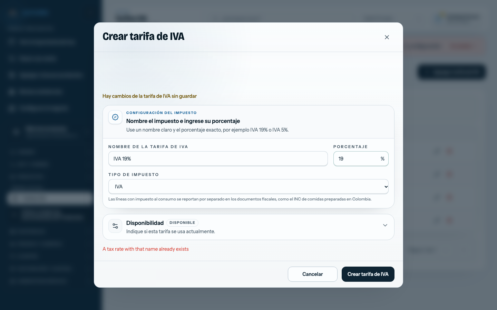
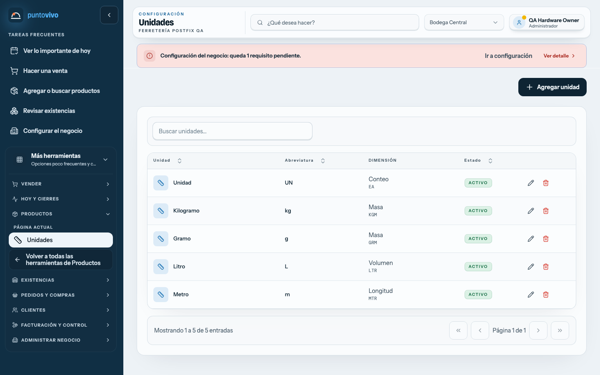
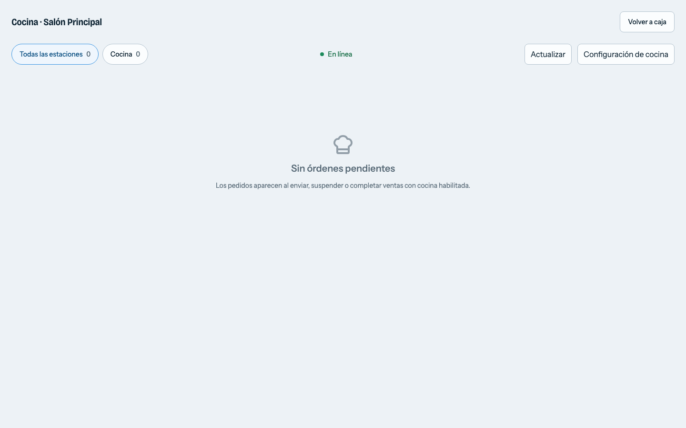
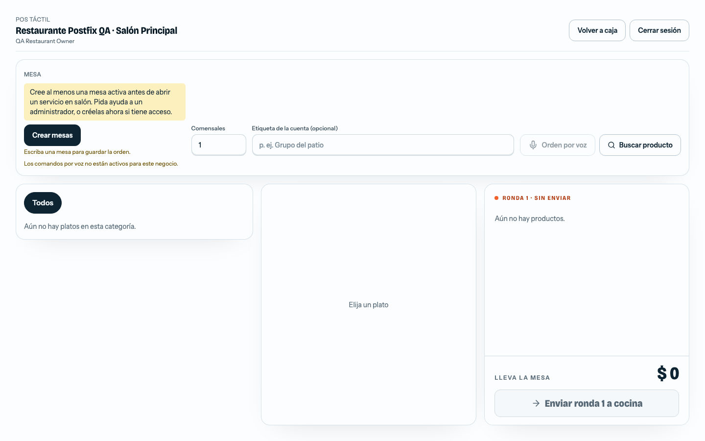
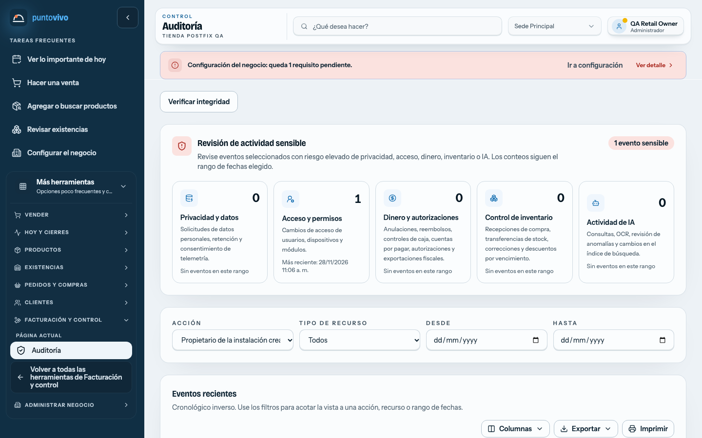
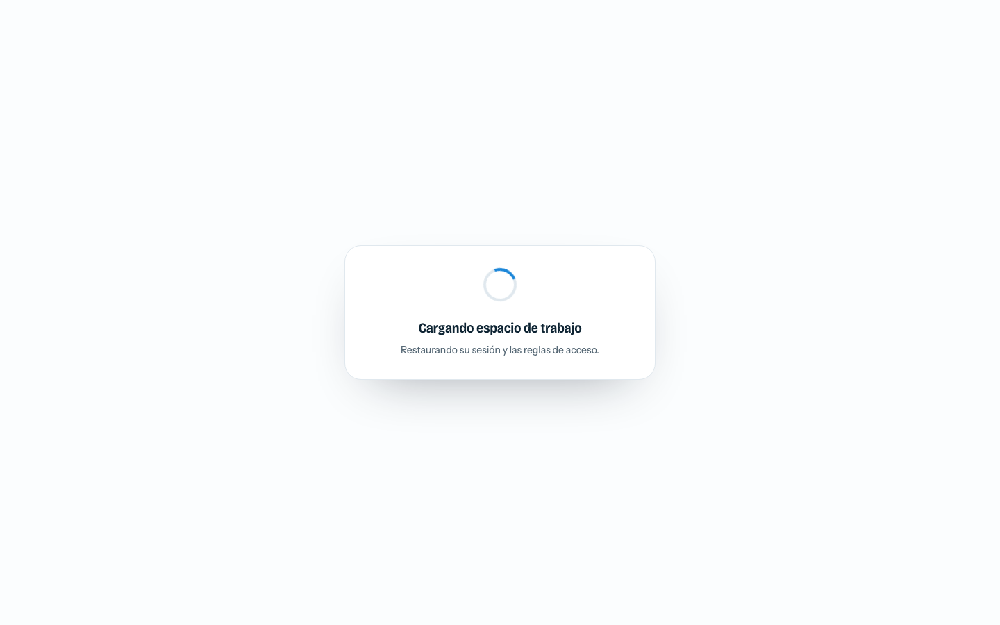
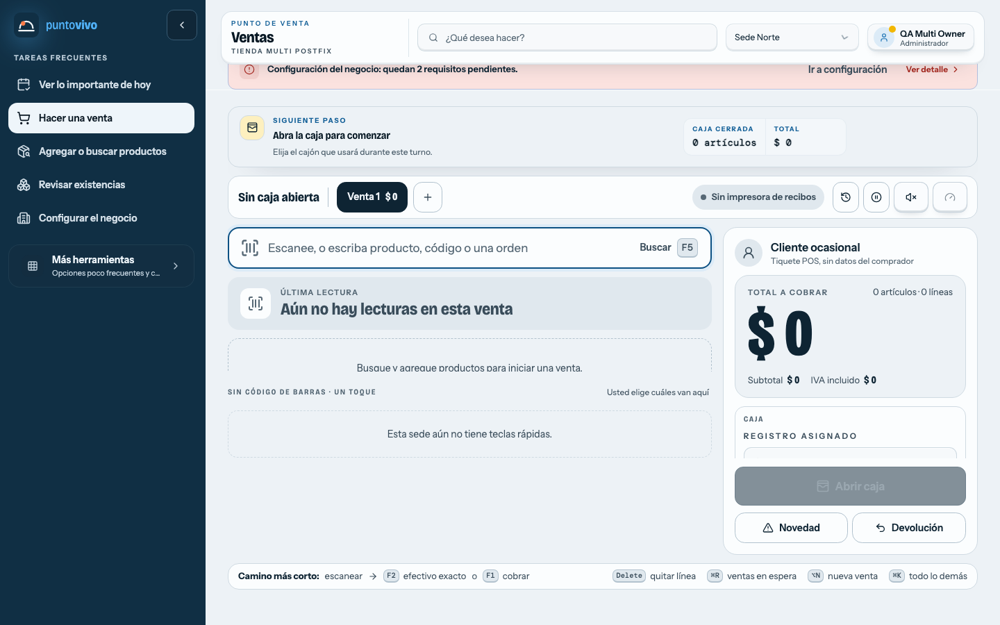
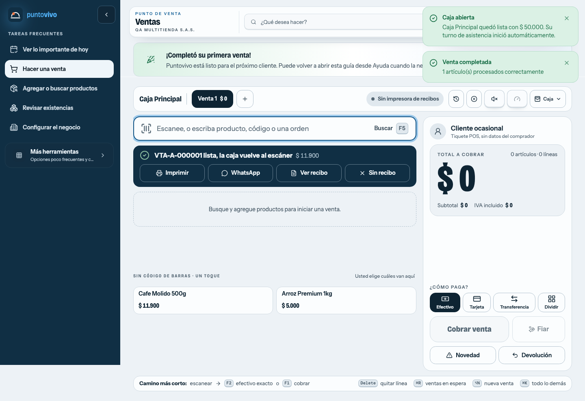
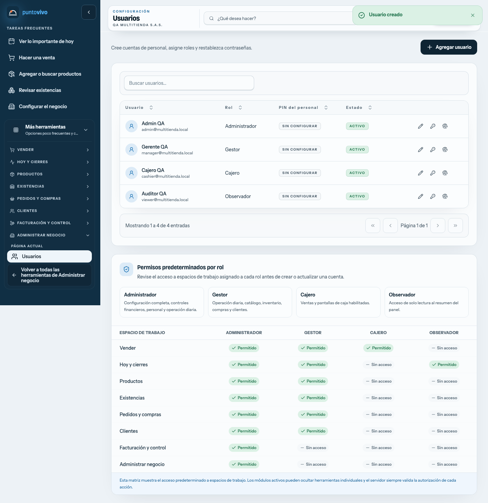
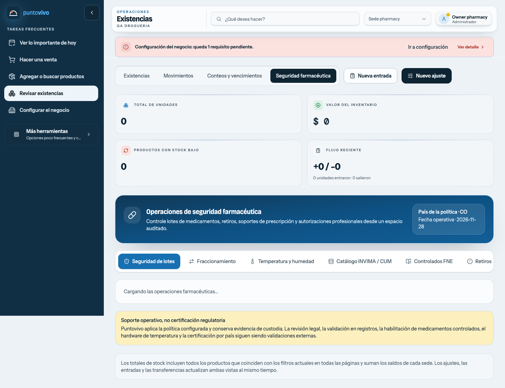

# Pre-Release Clean-Install QA Report

**Base commit:** `7b0a840a` (`main`)  
**Branch:** `qa/prerelease-full-audit`  
**Scope:** Clean installation (empty SQLite database, real owner registration, store setup), all 7 business verticals (`retail`, `restaurant`, `quickservice`, `wholesale`, `hardware`, `butchery`, `pharmacy`), single-site, multi-site, multi-user (`admin`, `manager`, `cashier`, `viewer`), sandboxed Electron desktop app, Web app, DB consistency, and performance/CPU/memory/backup/Lighthouse gates.

---

## Summary

| Area                                                      | Result         | Evidence                                                                                                                                                                                                        |
| --------------------------------------------------------- | -------------- | --------------------------------------------------------------------------------------------------------------------------------------------------------------------------------------------------------------- |
| Clean-install matrix (7/7 verticals)                      | **PASS**       | 0 error boundaries, 0 blank screens, 0 horizontal overflow (1440×900), 0 raw i18n keys, 0 `PRAGMA foreign_key_check` errors                                                                                     |
| Single-site → Multi-site → Multi-user                     | **PASS**       | Real onboarding, VAT setup, Site A/B sequentials, CSV product import, COP denomination drawer open, sale completion, site switch & drawer isolation, 4 roles verified (`admin`, `manager`, `cashier`, `viewer`) |
| Mechanical defects fixed with regression tests            | **19 / 19**    | 3 P0 accounting/integrity, 10 P1 security/permissions/multi-site/UX, 6 P2 reporting/units/gating/a11y                                                                                                           |
| Design finding documented                                 | **1**          | Cross-site sequential prefix collision risk (`sequentials.upsert`)                                                                                                                                              |
| Sequential CI gates (`ci:server`, `ci:web`, `ci:desktop`) | **3 / 3 PASS** | Full coverage, lint, typecheck, dependency audit, 5 server perf profiles, Lighthouse 16/16, Electron memory 6/6, main-thread 3/3                                                                                |
| Live smoke post-fix (Electron + Web)                      | **PASS**       | `e2e/electron/manager-approval.spec.ts` PASS (18.4 s) + 7 live clean-install UI verifications                                                                                                                   |

---

## Fixed Defects (19)

### P0 — Financial & Data Integrity (3)

1. **`sales.void` credit receivable leak** (`packages/server/src/application/sales/voidSale.ts`): Voiding a credit or split cash+credit sale did not reverse `customer_ledger_entries`. Fixed by inserting a negative `adjustment` ledger entry inside the `BEGIN IMMEDIATE` transaction and recording the journal effect.
2. **`purchases.void` vs linked supplier payable invoices** (`packages/server/src/application/purchases/voidPurchase.ts`): Allowed voiding purchases already linked via `provider_payable_invoice_purchases` or `provider_payable_invoices.purchase_id`. Fixed by blocking inside `BEGIN IMMEDIATE` with `BAD_REQUEST` + `PURCHASE_VOID_PAYABLE_LINKED` (EN/ES translated).
3. **`comprehensive-day-close` carried-over draft attribution** (`packages/server/src/services/reports/comprehensive-day-close.ts`): `grossSales()` filtered on `sales.createdAt` instead of `coalesce(sales.checkoutCompletedAt, sales.createdAt)`, dropping Day-1 drafts and overnight restaurant checks completed on Day 2.

### P1 — Security, Permissions, Multi-Site, Integrity & Navigation (10)

4. **`purchases.void` stale parent order status** (`packages/server/src/application/purchases/voidPurchase.ts`): Voiding received purchases left `orders.status` stuck at `received`/`partial_received`. Now recomputes remaining active receipts inside the transaction, reverts to `submitted`/`partial_received`, and enqueues an `orders` sync update.
5. **`closeCashSession` TOCTOU `overShort` calculation** (`packages/server/src/application/cash-sessions/closeCashSession.ts`): Computed `overShort` before opening a deferred transaction. Now runs `BEGIN IMMEDIATE`, re-reads authoritative `expectedBalance`, and writes consistent values to the row, audit log, and journal.
6. **Draft privacy across `sales.list`, `sales.getById`, and `peripherals` receipt renderers** (`packages/server/src/application/sales/draft-ownership.ts`, `packages/server/src/trpc/routers/sales/queries.ts`, `packages/server/src/trpc/routers/peripherals/queries.ts`): Excluded drafts from unfiltered `sales.list`, enforced role/owner visibility when `status='draft'`, and added shared `assertCanViewSaleDraft` enforcement on `sales.getById`, `renderReceiptHtml`, `renderReceiptShare`, and `buildReceiptBytes`.
7. **`sales.summary` exposed tenant-wide revenue KPIs to cashiers** (`packages/server/src/trpc/routers/sales/queries.ts`, `apps/web/src/features/sales/usePrefetchSales.ts`): Moved `sales.summary` from `tenantProcedure` to `dashboardReadProcedure` and removed unused `sales.summary.prefetch()` on `/sales` hover.
8. **`cashSessions.getActive` / `myPace` / `myShiftSummary` ignored `input.siteId`** (`packages/server/src/trpc/routers/cashSessions.ts`): Now honor `input?.siteId ?? ctx.siteId` with `ensureTenantSite` validation.
9. **Raw SQLite `UNIQUE constraint failed` shown on duplicate VAT rate name** (`packages/server/src/trpc/routers/vatRates.ts`): Checks duplicate names inside `BEGIN IMMEDIATE` on `create`/`update` and throws typed `CONFLICT` + `VAT_RATE_NAME_DUPLICATE` (EN/ES translated).
10. **Incomplete vertical preset module maps** (`packages/server/src/services/modules/presets.ts`): `restaurant`, `quickservice`, and `wholesale` omitted `quotations`/`delivery`. All 7 presets now declare every key in `PRESET_SCOPED_MODULES` explicitly.
11. **Multi-site stale cache bleed & missing `siteId` on `listDrafts`** (`apps/web/src/features/tenant/siteSelection.ts`, `apps/web/src/features/tenant/TenantProviderImpl.tsx`, `apps/web/src/features/sales/useSalesPageData.ts`): Persists `siteId` synchronously on switch, resets site-scoped queries immediately, drops `keepPreviousData` on `cashSessions.getActive` with explicit `siteId` check, and passes `siteId` to `sales.listDrafts`.
12. **Fullscreen surfaces `/kds`, `/touch/voice`, and `/m` trapped Electron operators** (`apps/web/src/features/kds/KdsBoard.tsx`, `apps/web/src/features/restaurants/VoiceOrderingScreen.tsx`): Added accessible non-destructive Back to register / Volver a caja link.
13. **Dead sidebar `/m` link when `mobile-waiter` is active while `dine-in` is off** (`apps/web/src/components/layout/workspaces.ts`): Added `requiredModules: ['mobile-waiter', 'dine-in']` matching `App.tsx`.

### P2 — Reporting Precision, Initial Units, Role Gating & Accessibility (6)

14. **`day-close.ts` owner pulse refund window off-by-1ms** (`packages/server/src/services/reports/day-close.ts`): Passes `previousWeekEndExclusive` (`+1 day 00:00:00.000Z`) instead of inclusive `23:59:59.999Z` to `windowReturnedAmountSql`.
15. **Clean-install `hardware` vertical missing length unit (`Metro`/`m`)** (`packages/server/src/services/installation/setup.ts`): Seeds `Metro` / `Meter` (`m`, `dimension: 'length'`, `standardCode: 'MTR'`) on clean install so `hardware-length` template works immediately.
16. **Manager UI rendered links to admin-only `/operations?tab=...` recovery tabs** (`apps/web/src/components/layout/SyncConflictsPill.tsx`, `apps/web/src/features/dashboard/today/PendingQueue.tsx`): Gated on `user?.role === 'admin'` and active `operations-center` module.
17. **Blank panel on `/company?tab=restaurant` when `dine-in` is inactive** (`apps/web/src/features/company/CompanyPage.tsx`): Falls back to default tab (`readiness`).
18. **Guided setup "Continue to sales" CTA ignored touch-register verticals** (`apps/web/src/features/company/CompanyReadinessCard.tsx`): Routes via `useSellingRoute().route` (`/touch` vs `/sales`).
19. **`AuditLogsPage` `<label>` wrapping `<select>` caused accessible-name collision** (`apps/web/src/features/audit-logs/AuditLogsPage.tsx`): Converted filter fields to explicit `htmlFor`/`id` bindings; verified live with `e2e/electron/manager-approval.spec.ts` passing in 18.4 s.

---

## Design Finding (Open Product Decision — Not Changed)

- **[P1 — Design] Cross-site sequential number collisions (`packages/server/src/trpc/routers/sequentials.ts`):** Document uniqueness indexes (`idx_sales_tenant_number`, etc.) are tenant-wide `(tenant_id, sale_number)`, while `sequentials` only enforces uniqueness per `(tenant_id, site_id, document_type)` and permits identical or empty prefixes across two sites of the same tenant. Product decision needed on whether to enforce unique `(tenant_id, document_type, prefix)` or auto-namespace prefixes by site.
- **Note on legacy Electron E2E specs:** 5/11 passed on baseline (`installation-setup`, `backup-worker`, `restaurant-service`, `pharmacy-operations`, `pharmacy-roles`), `manager-approval` now passes after fix #19, 4 older specs have stale UI selectors (`staff-switch`, `first-owner-retail`, `blind-close`, `inventory-transfer`), and `day-close` hit a benign Chromium shutdown warning (`pref_notifier_impl.cc:26`).

---

## Post-Fix Performance, CPU, Memory & Lighthouse Evidence

### Electron Memory & Cold Startup (`ci:desktop` — 6/6 PASS)

| Metric                         |     Measured |    Budget |   Allowed | Status |
| ------------------------------ | -----------: | --------: | --------: | ------ |
| `startup.firstWindowMs (cold)` |   **500 ms** | 20 000 ms | 27 000 ms | PASS   |
| `memory.main (cold)`           | **310.5 MB** |    282 MB |  352.5 MB | PASS   |
| `memory.renderer (cold)`       | **124.7 MB** |    165 MB |  206.3 MB | PASS   |
| `memory.gpu (cold)`            |  **85.3 MB** |    169 MB |  211.3 MB | PASS   |
| `memory.utility (cold)`        |  **54.6 MB** |    121 MB |  151.3 MB | PASS   |
| `memory.total (cold)`          | **574.9 MB** |    671 MB |  838.8 MB | PASS   |

### Electron Main Thread & IPC (`ci:desktop` — 3/3 PASS)

- 3 cold rounds × 468 HTTP sales (**0 failed**, p50 ~27.8 ms / p95 56.3 ms)
- `mainThread.blockedPercent`: **0.1%** (budget 5%) — PASS
- `mainThread.maxStallMs`: **13.7 ms** (budget 100 ms) — PASS
- `ipc.p99Ms`: **0.4 ms** (budget 15 ms) — PASS
- `profile:backup:ci`: **PASS**

### Web Lighthouse (`ci:web` — 16/16 PASS)

| Route               |         Score |      LCP |      TTI |   CLS | Status |
| ------------------- | ------------: | -------: | -------: | ----: | ------ |
| `authenticatedBoot` | **95** (≥ 70) | 1 494 ms | 1 494 ms |     0 | PASS   |
| `dashboard`         | **92** (≥ 66) | 1 734 ms | 1 734 ms | 0.001 | PASS   |
| `sales`             | **88** (≥ 69) | 2 288 ms | 2 288 ms | 0.008 | PASS   |
| `products`          | **92** (≥ 62) | 1 804 ms | 1 804 ms |     0 | PASS   |

### Server SQLite & tRPC Profiles (`ci:server:perf` — 5/5 PASS)

- `perf:trpc`, `perf:store`, `perf:search` (1k/10k/50k retail + pharmacy), `perf:sale` (50k catalog, p95 43.14 ms), `perf:audit` (100k chain verify 1 016.6 ms / redact 1 500.7 ms) — all PASS.

---

## Visual Evidence (Screenshots)

### Duplicate VAT Rate Localized Conflict (Fix #9)

### Hardware Clean Install — Seeded Meter Unit (Fix #15)

### Fullscreen Surfaces Back-to-Register Links (Fix #12)

### Audit Logs Filter Accessible Labels (Fix #19)

### Company Restaurant Tab Fallback When Dine-In Off (Fix #17)

### Multi-Site Switch Clears Previous Site Cash Session Immediately (Fix #11)

### Clean-Install Topology & Vertical Coverage Highlights

